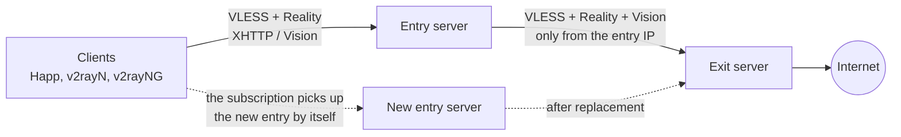

# VPS-VPN Monitor

[Русский](README.md) · **English**

A desktop app for **Windows 11** that sets up and maintains your VPS running
[Xray-core](https://github.com/XTLS/Xray-core): it installs Xray, builds an **"entry → exit" cascade**,
monitors servers and per-key traffic, and when the entry server becomes unreachable it
**replaces only the entry**. The exit server and its IP stay the same.

> Status: **beta**. The app runs on the author's own servers but has not been tested at scale.
> The interface is available in Russian and English (switch at the bottom of the menu). Windows 11 x64 only.

[](LICENSE)

---

## Contents

- [Core idea: only the entry changes](#core-idea-only-the-entry-changes)
- [Features](#features)
- [Requirements](#requirements)
- [Installation](#installation)
- [Quick start](#quick-start)
- [How entry replacement works](#how-entry-replacement-works)
- [What the app does on the server](#what-the-app-does-on-the-server)
- [Where data is stored on the PC](#where-data-is-stored-on-the-pc)
- [Security](#security)
- [Building from source](#building-from-source)
- [Project layout](#project-layout)
- [Limitations](#limitations)
- [Disclaimer](#disclaimer)
- [License](#license)

---

## Core idea: only the entry changes

A typical VPN is a single server: if its IP becomes unreachable, you set up a new server, hand out
new keys to everyone, and websites see a new IP (repeated logins, captchas, anti-fraud checks).
VPS-VPN Monitor builds a **cascade with two roles**:



- The **entry server** accepts client connections. It is on the front line: its IP is the one most
  likely to become unreachable (hosting failure, address blocking, moving to another provider).
- The **exit server** sends traffic to the internet. Clients never connect to it directly: its port is
  open only to the entry IPs, so it stays mostly unexposed.

When the entry stops working, the **"Replace entry"** wizard brings up a new entry server within minutes,
with the **same keys (UUIDs) and names**, and connects it to the **same exit**:

- **The IP seen by websites does not change** — it is the exit IP. Services do not see a "country change",
  sessions and address reputation are preserved.
- **Keys are not reissued.** People connected through a subscription link do nothing:
  their client gets the new entry address on the next subscription update.
- **The old entry can be restored** ("Undo replacement") or have its access to the exit closed.

## Features

**Server setup** (by IP and root password; the password is not stored)
- Modes: single server, "entry → exit" cascade, or both.
- Installs Xray from official releases, UFW, fail2ban; VLESS + Reality inbounds over **XHTTP** and **Vision**.
- Automatic choice of the Reality masking site (SNI): candidates are checked for TLS 1.3, HTTP/2, X25519 and speed.
- A separate SSH key per server; every change is recorded in a manifest, so it can be rolled back
  or removed completely with "Remove settings".

**Entry replacement** — see [below](#how-entry-replacement-works).

**Monitoring**
- Overview grouped by cascade: server state, Xray, the "entry → exit" link.
- Traffic per key: today and by day (charts), current speed, volume before tracking started.
- Plan traffic limits with a reset day and a correction from the hosting panel; Windows notifications.
- A traffic collector on the server (systemd timer): statistics are kept while your PC is off.

**Management**
- Xray keys: add / delete (backup, `xray run -test`, automatic rollback), links and QR codes
  with a choice of fingerprint.
- Restart Xray and reboot the server, enable/disable password login (with a safety timer), change the root password.
- Built-in SSH terminal with tabs.
- Interface language: Russian or English, switched without a restart (on first launch it follows the Windows language).
  The subscription site has its own language: VPN users see it, not the administrator.

**Subscription site** (optional)
- A personal link for each person: a page with a QR code and instructions, and the VPN client gets
  the subscription from the same link. The site is static files served by Caddy on the exit server, HTTPS only.
- When the entry is replaced, subscriptions switch to the new entry automatically.

## Requirements

### Your computer

| What | Why |
|---|---|
| Windows 11 x64 | the app is built for Windows only |
| ~300 MB of disk space | the app (Electron) |
| SSH access to the servers (port 22) | the app talks to servers over SSH only |

**Nothing else is needed to install from the .exe** — no Node.js, Python or Git on your PC.

### Servers

| What | Requirement |
|---|---|
| OS | Ubuntu 22.04 / 24.04 or Debian 12 (clean install) |
| Architecture | x86_64 or arm64 |
| Access | root over SSH (password for the first connection) |
| Resources | 1 core and 1 GB RAM or more; traffic as you need |
| Count | 1 (single) or 2+ (cascade: entry + exit, preferably with different providers) |
| Domain | only for the subscription site: an A record pointing to the exit IP |

Python 3, curl and systemd are already present on these systems; the app installs what is missing (UFW, fail2ban, unzip).
Pick the exit server in the country whose IP websites should see.

### Clients (users' devices)

You need a client based on the **Xray** core that supports VLESS + Reality and XHTTP, for example
[Happ](https://happ.su/) (Windows, Android, iOS, Linux), [v2rayN](https://github.com/2dust/v2rayN),
[v2rayNG](https://github.com/2dust/v2rayNG). Clients based on sing-box may not support XHTTP —
use the Vision keys for them.

### Building from source (developers only)

| Program | Version | Why |
|---|---|---|
| [Node.js](https://nodejs.org/) (with npm) | 22 LTS | running, tests, building |
| [Git](https://git-scm.com/download/win) | any recent | getting the code |
| [Python](https://www.python.org/downloads/windows/) | 3.10+ | only for server script tests (`npm run test:py`) |

## Installation

1. Download `VPS-VPN-Monitor-Setup-<version>.exe` from the
   [Releases](https://github.com/qqoe-sys/vps-vpn-monitor/releases) page.
2. Compare the checksum with the one in the release (PowerShell):
   ```powershell
   Get-FileHash .\VPS-VPN-Monitor-Setup-0.2.0.exe -Algorithm SHA256
   ```
3. Run the installer. It is not code-signed, so SmartScreen shows
   "Windows protected your PC" → **More info** → **Run anyway**.
4. The app installs into your user profile (no administrator rights needed), with shortcuts on the desktop and in Start.

Uninstall: "Settings → Apps → VPS-VPN Monitor → Uninstall". Data in `%APPDATA%\vps-monitor`
is kept — delete the folder manually if you no longer need it (it contains your SSH keys!).

## Quick start

1. **Get two VPS** (entry and exit) with Ubuntu 24.04. Write down their IPs and root passwords.
2. **"+ Add server"** → **"Cascade"** mode → IPs and passwords of both servers → choose which one is the entry.
   The app shows the servers' key fingerprints — confirm them. Then it will by itself:
   check the servers, install Xray and UFW, choose an SNI, create keys and verify the "entry → exit → internet" path.
3. On the **"Keys & traffic"** tab, add a key for each person and share the link or QR code.
4. (Optional) **"Subscriptions"**: set a domain with an A record pointing to the exit → "Install site on server" →
   add people. Each gets a personal link that their client updates by itself.

## How entry replacement works

Entry server card → **"Replace entry"** → IP and root password of the **new** VPS. The wizard:

1. Checks the new server (OS, free ports, no existing Xray).
2. Takes the clients (UUIDs and names) from the old entry. If the old entry no longer responds — from the copy
   the app saves on the PC every 10 minutes.
3. Installs Xray on the new entry with the **same clients** and a link to the **same exit** (Vision).
   The SNI is chosen again — among sites close to the new server.
4. On the exit, adds a UFW rule for the new entry IP — under a safety timer with automatic rollback.
5. Checks the "new entry → exit → internet" path on every inbound (443 and 8443).
6. Switches subscriptions to the new entry and publishes them (with your confirmation).
7. Marks the old entry as "replaced". Then you can: **"Undo replacement"**,
   **"Close access on exit"** for the old IP, **"Remove server from list"**.

Users with subscriptions do nothing. Users with plain keys (no subscription) only get a new server
address in the link — the app shows the new links and QR codes.

## What the app does on the server

Everything the app creates on the server is listed in `/var/lib/vpsmon/manifest.json`,
and **"Remove settings"** removes it from the server.

| What | Where |
|---|---|
| Xray (binary, geo databases, service, `xray` user) | `/usr/local/bin/xray`, `/usr/local/share/xray`, `/usr/local/etc/xray/config.json`, `xray.service` |
| Traffic collector | `/usr/local/lib/vpsmon`, `/var/lib/vpsmon/traffic.json`, `vpsmon-collector.timer` |
| UFW rules, fail2ban | only the required ports (22, Xray ports; on the exit, 443 only from the entry IPs) |
| App key | a line in `/root/.ssh/authorized_keys` |
| Subscription site (if enabled) | Caddy, `/var/www/vpsmon-sub`, port 80 (certificate issuance only) and the chosen HTTPS port |

Server polling only **reads** state (every 10 seconds, heavier data once a minute).

## Where data is stored on the PC

`%APPDATA%\vps-monitor\` — the server list, SSH keys (`keys\`), server fingerprints (`known_hosts`),
traffic history, subscriptions, settings. Details and risks are in [SECURITY.md](SECURITY.md) (in Russian).

A backup is a copy of this folder. Keep it as carefully as your passwords.

## Security

In short (details in [SECURITY.md](SECURITY.md)):

- Electron runs sandboxed with a strict CSP; the interface has no access to files or Node.js.
- Every server's host key is verified; a new server is only trusted after you confirm its fingerprint.
- The root password is not stored; each server gets its own ed25519 key.
- Every change on a server: backup → config check → check that Xray came up → otherwise rollback.
  UFW and SSH changes run under a "dead man's switch" (a timer reverts them if the connection is lost).
- VPN clients cannot reach the server's internal addresses; the exit is open only to its own entries.
- **Weak points:** keys on the PC are not separately encrypted (protect your Windows account and disk),
  the installer is not signed, no third-party audit has been done.

Found a vulnerability? Report it privately as described in [SECURITY.md](SECURITY.md)
(GitHub **Security → Report a vulnerability**).

## Building from source

```powershell
git clone https://github.com/qqoe-sys/vps-vpn-monitor.git
cd vps-vpn-monitor
npm ci            # installs dependencies exactly as in package-lock.json
npm test          # logic tests (Node.js)
npm run test:py   # server script tests (requires Python 3)
npm start         # run from source
npm run dist      # installer: dist\VPS-VPN-Monitor-Setup-<version>.exe
```

`npm ci` and `npm run dist` download npm packages and Electron from the internet.
For development you can put your own `config\servers.json` (same format as `config\servers.default.json`) —
it is in `.gitignore` and never gets into the repository.

## Project layout

```
src/
  core/        logic without Electron or SSH (parsing server output, traffic, limits, subscriptions) — covered by tests
    provision/ server setup wizard: steps, Xray config, checks, SNI selection
    replace/   entry replacement wizard
  main/        Electron main process: window, SSH (ssh2), keys, IPC
  renderer/    interface (plain HTML/CSS/JS, no frameworks)
  i18n/        translations: ru.js, en.js (key → text) and the t() function; a new language = a new dictionary file
server/        scripts the app runs on servers over SSH (bash, Python 3)
test/          tests: node --test and Python unittest
tools/         helper scripts (icon, subscription site preview, collector installation)
config/        servers.default.json — an empty server list for a new installation
```

Interface texts are never written in the code directly, only through `t('key')`. Server scripts print codes
like `@E:code|argument`, and the app translates them into the user's language. `test/i18n.test.js` checks
that the dictionaries match and that no untranslated strings are left in the code.

Code comments are in Russian (the author's language); pull requests that translate them are welcome.

## Limitations

- Windows 11 x64 only; interface languages are Russian and English.
- Designed for **clean** servers: if Xray is already installed, the wizard refuses to set it up;
  other services may conflict on ports (the wizard checks that the required ports are free).
- Cascade setup and entry replacement have been tested on a small number of the author's servers.
- No automatic app updates — watch the releases.

## Disclaimer

VPS-VPN Monitor is a tool for administering **your own** servers. You are responsible for making sure
your use of it complies with the laws of your country, the country where the servers are hosted, and your
hosting providers' terms. The software is provided "as is", without any warranty (see [LICENSE](LICENSE)).

## License

[MIT](LICENSE) © 2026 qqoe-sys.
Third-party components and their licenses are listed in [THIRD-PARTY-NOTICES.md](THIRD-PARTY-NOTICES.md).
Xray-core, Caddy, Happ and other mentioned products belong to their authors; this project is not affiliated with them.
