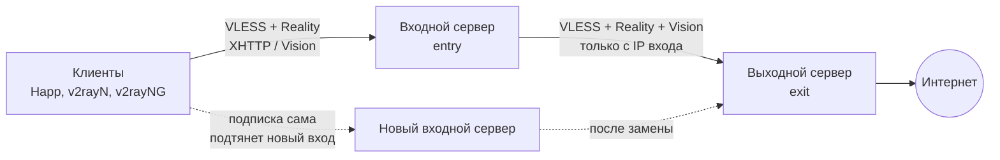

# VPS-VPN Monitor

**Русский** · [English](README.en.md)

Настольное приложение для **Windows 11**, которое настраивает и обслуживает ваши VPS с
[Xray-core](https://github.com/XTLS/Xray-core): ставит Xray, собирает **каскад «вход → выход»**,
следит за серверами и трафиком по ключам, а если входной сервер стал недоступен —
**меняет только вход**. Выходной сервер и его IP остаются прежними.

> Статус: **бета**. Приложение работает на реальных серверах автора, но массово не испытывалось.
> Интерфейс на русском и английском (переключатель внизу меню). Только Windows 11 x64.

[](LICENSE)

---

## Содержание

- [Главная идея: меняется только вход](#главная-идея-меняется-только-вход)
- [Возможности](#возможности)
- [Требования](#требования)
- [Установка](#установка)
- [Быстрый старт](#быстрый-старт)
- [Как работает замена входа](#как-работает-замена-входа)
- [Что программа делает на сервере](#что-программа-делает-на-сервере)
- [Где хранятся данные на ПК](#где-хранятся-данные-на-пк)
- [Безопасность](#безопасность)
- [Сборка из исходников](#сборка-из-исходников)
- [Устройство проекта](#устройство-проекта)
- [Ограничения](#ограничения)
- [Ответственность](#ответственность)
- [Лицензия](#лицензия)

---

## Главная идея: меняется только вход

Обычный VPN — это один сервер: если его IP становится недоступен, приходится поднимать новый
сервер, раздавать всем новые ключи, а сайты видят новый IP (повторные входы, капчи, проверки
антифрода). VPS-VPN Monitor строит **каскад из двух ролей**:



- **Входной сервер (entry)** принимает подключения клиентов. Он «на передовой»: именно его IP чаще
  всего становится недоступен (сбой у хостера, блокировка адреса, переезд к другому провайдеру).
- **Выходной сервер (exit)** выпускает трафик в интернет. Клиенты к нему напрямую не подключаются:
  его порт открыт только для IP входов, поэтому он почти не «засвечен».

Когда вход перестал работать, мастер **«Заменить вход»** за несколько минут поднимает новый
входной сервер с **теми же ключами (UUID) и именами** и подключает его к **тому же выходу**:

- **IP для внешних сайтов не меняется** — это IP выхода. Сервисы не видят «смены страны»,
  сессии и доверие к адресу сохраняются.
- **Ключи не перевыпускаются.** Тем, кто подключён через ссылку-подписку, ничего делать не нужно:
  клиент сам получит новый адрес входа при обновлении подписки.
- **Старый вход можно вернуть** («Отменить замену») или отключить ему доступ к выходу.

## Возможности

**Настройка серверов** (по IP и паролю root, пароль не сохраняется)
- Режимы: одиночный сервер, каскад «вход → выход» или оба сразу.
- Установка Xray из официальных релизов, UFW, fail2ban; входы VLESS + Reality по **XHTTP** и **Vision**.
- Автоподбор сайта для маскировки Reality (SNI): проверка кандидатов на TLS 1.3, HTTP/2, X25519 и скорость.
- Отдельный SSH-ключ для каждого сервера; все изменения записываются в манифест — их можно откатить
  или полностью удалить кнопкой «Удалить настройки».

**Замена входа** — см. [ниже](#как-работает-замена-входа).

**Мониторинг**
- Обзор, сгруппированный по каскадам: состояние серверов, Xray, связь «вход → выход».
- Трафик по каждому ключу: за сегодня и по дням (графики), текущая скорость, объём до начала учёта.
- Лимиты трафика тарифа с днём сброса и поправкой по панели хостера; уведомления Windows.
- Сборщик трафика на сервере (systemd-таймер): статистика не теряется, пока ПК выключен.

**Управление**
- Ключи Xray: добавить / удалить (бэкап, `xray run -test`, автооткат), ссылки и QR-коды
  с выбором fingerprint.
- Перезапуск Xray и перезагрузка сервера, вкл/выкл входа по паролю (с защитным таймером), смена пароля root.
- Встроенный SSH-терминал с вкладками.
- Язык интерфейса: русский или английский, переключается без перезапуска (при первом запуске — по языку Windows).
  У сайта подписок свой язык: его видят пользователи VPN, а не администратор.

**Сайт подписок** (необязательно)
- Личная ссылка для каждого человека: страница с QR-кодом и инструкцией, а VPN-клиент по той же ссылке
  получает подписку. Сайт — статичные файлы под Caddy на выходном сервере, только HTTPS.
- При замене входа подписки переключаются на новый вход автоматически.

## Требования

### Ваш компьютер

| Что | Зачем |
|---|---|
| Windows 11 x64 | приложение собрано только под Windows |
| ~370 МБ на диске | программа (Electron) |
| Доступ к серверам по SSH (порт 22) | программа ходит на серверы только по SSH |

Для **установки из .exe больше ничего не нужно** — Node.js, Python и Git на ПК не требуются.

### Серверы

| Что | Требование |
|---|---|
| ОС | Ubuntu 22.04 / 24.04 или Debian 12 (чистая установка) |
| Архитектура | x86_64 или arm64 |
| Доступ | root по SSH (пароль — для первого подключения) |
| Ресурсы | от 1 ядра и 1 ГБ RAM; трафик — по вашим нуждам |
| Количество | 1 (одиночный) или 2+ (каскад: вход + выход, лучше у разных провайдеров) |
| Домен | только для сайта подписок: A-запись на IP выхода |

Python 3, curl, systemd на этих ОС уже есть; недостающее (UFW, fail2ban, unzip) программа поставит сама.
Выходной сервер выбирайте в той стране, чей IP должны видеть сайты.

### Клиенты (устройства пользователей)

Нужен клиент на ядре **Xray**, поддерживающий VLESS + Reality и XHTTP: например
[Happ](https://happ.su/) (Windows, Android, iOS, Linux), [v2rayN](https://github.com/2dust/v2rayN),
[v2rayNG](https://github.com/2dust/v2rayNG). Клиенты на ядре sing-box могут не поддерживать XHTTP —
для них используйте ключи Vision.

### Для сборки из исходников (только разработчикам)

| Программа | Версия | Зачем |
|---|---|---|
| [Node.js](https://nodejs.org/) (вместе с npm) | 22 LTS | запуск, тесты, сборка |
| [Git](https://git-scm.com/download/win) | любая свежая | получить код |
| [Python](https://www.python.org/downloads/windows/) | 3.10+ | только для тестов серверных скриптов (`npm run test:py`) |

## Установка

1. Скачайте `VPS-VPN-Monitor-Setup-<версия>.exe` со страницы
   [Releases](https://github.com/qqoe-sys/vps-vpn-monitor/releases).
2. Сверьте контрольную сумму с указанной в релизе (PowerShell):
   ```powershell
   Get-FileHash .\VPS-VPN-Monitor-Setup-0.2.1.exe -Algorithm SHA256
   ```
3. Запустите установщик. Установщик не подписан сертификатом, поэтому SmartScreen покажет
   «Windows защитила ваш компьютер» → **Подробнее** → **Выполнить в любом случае**.
4. Программа ставится в профиль пользователя (права администратора не нужны), ярлыки — на рабочем столе и в «Пуске».

Удаление: «Параметры → Приложения → VPS-VPN Monitor → Удалить». Данные в `%APPDATA%\vps-monitor`
остаются — удалите папку вручную, если они больше не нужны (там ваши SSH-ключи!).

## Быстрый старт

1. **Купите два VPS** (вход и выход) с Ubuntu 24.04. Запишите IP и пароли root.
2. **«+ Добавить сервер»** → режим **«Каскад»** → IP и пароли обоих серверов → выберите, какой будет входом.
   Программа покажет отпечатки ключей серверов — подтвердите. Дальше она сама:
   проверит серверы, поставит Xray и UFW, подберёт SNI, создаст ключи, проверит путь «вход → выход → интернет».
3. Во вкладке **«Ключи и трафик»** добавьте ключ для каждого человека и отдайте ссылку или QR-код.
4. (Необязательно) **«Подписки»**: укажите домен с A-записью на выход → «Установить сайт на сервер» →
   добавьте людей. Каждый получит личную ссылку, которую клиент обновляет сам.

## Как работает замена входа

Карточка входного сервера → **«Заменить вход»** → IP и пароль root **нового** VPS. Мастер:

1. Проверяет новый сервер (ОС, свободные порты, нет ли уже Xray).
2. Берёт клиентов (UUID и имена) со старого входа. Если старый вход уже не отвечает — из копии,
   которую программа сохраняет на ПК каждые 10 минут.
3. Ставит Xray на новый вход с **теми же клиентами** и звеном на **тот же выход** (Vision).
   SNI подбирается заново — по сайтам, близким к новому серверу.
4. На выходе добавляет в UFW правило для IP нового входа — под защитным таймером с автооткатом.
5. Проверяет путь «новый вход → выход → интернет» на каждом входе (443 и 8443).
6. Переключает подписки на новый вход и публикует их (с вашим подтверждением).
7. Помечает старый вход как «заменён». Дальше можно: **«Отменить замену»**,
   **«Закрыть доступ на выходе»** для старого IP, **«Удалить сервер из списка»**.

Пользователям с подписками делать ничего не нужно. У пользователей с обычными ключами (без подписки)
меняется только адрес сервера в ссылке — программа покажет новые ссылки и QR-коды.

## Что программа делает на сервере

Всё, что программа создаёт на сервере, перечислено в `/var/lib/vpsmon/manifest.json`,
и кнопка **«Удалить настройки»** убирает это с сервера.

| Что | Где |
|---|---|
| Xray (бинарник, геобазы, служба, пользователь `xray`) | `/usr/local/bin/xray`, `/usr/local/share/xray`, `/usr/local/etc/xray/config.json`, `xray.service` |
| Сборщик трафика | `/usr/local/lib/vpsmon`, `/var/lib/vpsmon/traffic.json`, `vpsmon-collector.timer` |
| Правила UFW, fail2ban | только нужные порты (22, порты Xray; на выходе 443 — только с IP входов) |
| Ключ программы | строка в `/root/.ssh/authorized_keys` |
| Сайт подписок (если включён) | Caddy, `/var/www/vpsmon-sub`, порт 80 (только выпуск сертификата) и выбранный порт HTTPS |

Опрос серверов только **читает** состояние (раз в 10 секунд, тяжёлые данные — раз в минуту).

## Где хранятся данные на ПК

`%APPDATA%\vps-monitor\` — список серверов, SSH-ключи (`keys\`), отпечатки серверов (`known_hosts`),
история трафика, подписки, настройки. Подробно и про риски — в [SECURITY.md](SECURITY.md).

Резервная копия = копия этой папки. Храните её так же бережно, как пароли.

## Безопасность

Коротко (подробно — [SECURITY.md](SECURITY.md)):

- Electron в режиме песочницы, строгая CSP, без доступа интерфейса к файлам и Node.js.
- Проверка ключа каждого сервера; новый сервер — только после вашего подтверждения отпечатка.
- Пароль root не сохраняется; для каждого сервера — свой ключ ed25519.
- Любое изменение на сервере: бэкап → проверка конфига → проверка, что Xray поднялся → иначе откат.
  Изменения UFW и SSH — под «мёртвой рукой» (таймер сам вернёт как было, если связь пропала).
- Клиенты VPN не могут ходить на внутренние адреса сервера; выход открыт только для своих входов.
- **Слабые места:** ключи на ПК не шифруются отдельно (защищайте учётную запись Windows и диск),
  установщик не подписан, сторонний аудит не проводился.

Нашли уязвимость — сообщите приватно, как описано в [SECURITY.md](SECURITY.md).

## Сборка из исходников

```powershell
git clone https://github.com/qqoe-sys/vps-vpn-monitor.git
cd vps-vpn-monitor
npm ci            # ставит зависимости строго по package-lock.json
npm test          # тесты логики (Node.js, ~1 с)
npm run test:py   # тесты серверных скриптов (нужен Python 3)
npm start         # запуск из исходников
npm run dist      # установщик: dist\VPS-VPN-Monitor-Setup-<версия>.exe
```

`npm ci` и `npm run dist` скачивают пакеты npm и Electron из интернета.
Для разработки можно положить свой `config\servers.json` (формат как у `config\servers.default.json`) —
он в `.gitignore` и в репозиторий не попадёт.

## Устройство проекта

```
src/
  core/        логика без Electron и SSH (разбор ответов серверов, трафик, лимиты, подписки) — покрыта тестами
    provision/ мастер добавления серверов: шаги, конфиг Xray, проверки, подбор SNI
    replace/   мастер замены входа
  main/        главный процесс Electron: окно, SSH (ssh2), ключи, IPC
  renderer/    интерфейс (обычный HTML/CSS/JS без фреймворков)
  i18n/        переводы: ru.js, en.js (ключ → текст) и функция t(); новый язык = новый файл-словарь
server/        скрипты, которые программа запускает на серверах по SSH (bash, Python 3)
test/          тесты: node --test и Python unittest
tools/         вспомогательные скрипты (иконка, предпросмотр сайта подписок, установка сборщика)
config/        servers.default.json — пустой список серверов для новой установки
```

Тексты интерфейса не пишутся в коде напрямую: только через `t('ключ')`. Серверные скрипты печатают коды
вида `@E:код|аргумент`, программа переводит их на язык пользователя. Тест `test/i18n.test.js` проверяет,
что словари совпадают и в коде не осталось непереведённых строк.

Принцип: всё, что можно проверить без сервера, вынесено в `src/core` и покрыто тестами;
серверные скрипты получают данные через stdin/base64 и не печатают секреты.

## Ограничения

- Только Windows 11 x64; языки интерфейса — русский и английский.
- Рассчитано на **чистые** серверы: если на сервере уже есть Xray, мастер откажется его настраивать;
  с другими службами возможен конфликт по портам (мастер проверяет, что нужные порты свободны).
- Режим каскада в мастере добавления и замена входа проверены на небольшом числе серверов автора.
- Нет автообновления программы — следите за релизами.

## Ответственность

VPS-VPN Monitor — инструмент администрирования **ваших собственных** серверов. Вы сами отвечаете за то,
чтобы его использование соответствовало законам вашей страны, страны размещения серверов и правилам
хостинг-провайдеров. Программа распространяется «как есть», без каких-либо гарантий (см. [LICENSE](LICENSE)).

## Лицензия

[MIT](LICENSE) © 2026 qqoe-sys.
Сторонние компоненты и их лицензии — в [THIRD-PARTY-NOTICES.md](THIRD-PARTY-NOTICES.md).
Xray-core, Caddy, Happ и другие упомянутые продукты принадлежат их авторам; проект с ними не связан.
